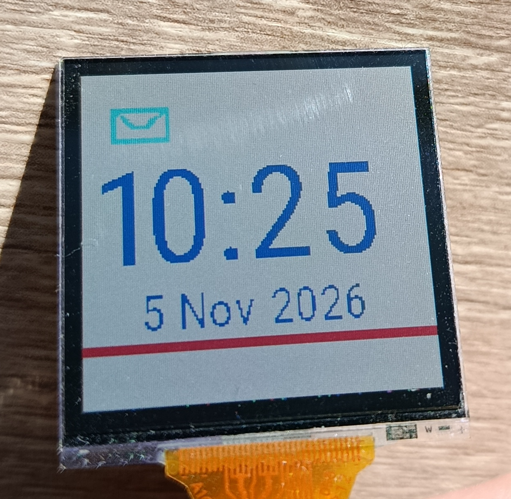

# 3-Color MIP Display Driver for STM32

A C driver for 3-color Memory-in-Pixel (MIP) displays from JDI and Sharp that
use SPI. It uses the STM32 Hardware Abstraction Layer (HAL) for SPI and GPIO
communication and provides a framebuffer, drawing primitives, bitmap icons,
and bitmap fonts.



Low power consumption is one of the key advantages of MIP displays. This
driver is designed with energy efficiency in mind: it keeps a framebuffer and
lets the application refresh only the rows that have changed, avoiding
unnecessary display data transfers. Actual power consumption depends on the
display module, its configuration, and how the application uses it.

The driver is intended to support compatible 3-color SPI MIP displays across
different resolutions. Its display dimensions are defined by macros in
`Driver/Inc/MIP-8c/mip-8c-display.h`; update those macros for the target
display. Compatibility also depends on the display using a compatible SPI
command and pixel-data format, so check the target module's datasheet.

The driver has been tested only with the JDI LPM013M126A (176 × 176). Other
JDI and Sharp models are intended targets but have not yet been verified.

The repository also contains a CubeMX-generated example project targeting the
STM32WB55 (`STM32WB55RGVx`). The example initializes the driver, draws graphics
and text, and refreshes only the modified screen area.

## Repository contents

- `Driver/` — display driver headers, implementation, icon and font assets.
- `Example/` — STM32WB55 CubeMX project that demonstrates the driver.

## Adding the driver to your project

1. Get the repository by cloning it:

   ```sh
   git clone https://github.com/Piorkos/mip-8color-display.git
   ```

   Alternatively, download the repository archive from GitHub and extract it.
2. Copy the `Driver/` directory into your project.
3. Add `Driver/Src/MIP-8c/mip-8c-display.c` to your build.
4. Add the asset source files you want to use:
   - `Driver/Src/MIP-8c/graphics/gfx_icons.c` for the supplied icons;
   - `Driver/Src/MIP-8c/graphics/fonts/font_bitmap_robo_cond_s.c`,
     `font_bitmap_robo_cond_m.c`, and/or `font_bitmap_robo_cond_l.c` for the
     supplied font sizes.
5. Add `Driver/Inc` to your compiler's include paths.
6. Configure the STM32 HAL SPI and GPIO peripherals, then initialize the
   display as shown below.

The driver currently includes STM32WB HAL headers (`stm32wbxx_hal.h` and
`stm32wbxx_hal_spi.h`). Using it with a different STM32 family may require
changing those includes to the corresponding HAL headers. The example uses
SPI master, 8-bit data, MSB first, and SPI mode 0; make sure your SPI settings
also meet these requirements.

The display's chip-select pin must be configured as a GPIO output. The driver
controls that pin during transfers.

## Quick start

Include the driver header and initialize it after the SPI and GPIO peripherals
have been initialized:

```c
#include "MIP-8c/mip-8c-display.h"
#include "MIP-8c/graphics/gfx_icons.h"
#include "MIP-8c/graphics/gfx_font.h"

MIP_8c_Display_Config_t display_config = {
    .hspi = &hspi1,
    .cs_port = SPI_CS_DISPLAY_GPIO_Port,
    .cs_pin = SPI_CS_DISPLAY_Pin
};

MIP_8c_Display_Init(&display_config);

MIP_8c_Display_DrawHorizontalLine(0, JDI_8COL_WHITE);
MIP_8c_Display_DrawShape(15, 20, JDI_8COL_CYAN, &gfx_icon_envelope);
MIP_8c_Display_DrawText(10, 40, JDI_8COL_BLUE, &gfx_font_bitmap_robo_cond_l, "10:25");

MIP_8c_Display_RefreshScreen(0, SCREEN_HEIGHT_IN_PIXELS);
```

`hspi1`, `SPI_CS_DISPLAY_GPIO_Port`, and `SPI_CS_DISPLAY_Pin` are examples;
replace them with the SPI handle and chip-select GPIO from your project. The
display starts with a white framebuffer after initialization. Drawing modifies
the framebuffer in RAM; call `MIP_8c_Display_RefreshScreen` to transmit the
changed rows to the display.

The repository's complete usage example is in
[`Example/Core/Src/main.c`](Example/Core/Src/main.c). Its CMake project
references `../Driver`, so keep the `Driver/` and `Example/` directories
side-by-side when building that project.

## Display dimensions and colors

The default configuration is for a 176 × 176 pixel display with 3 bits per
pixel, matching the tested JDI LPM013M126A. To target another resolution,
update `SCREEN_WIDTH_IN_PIXELS` and `SCREEN_HEIGHT_IN_PIXELS` in
`Driver/Inc/MIP-8c/mip-8c-display.h` and ensure the target display's SPI
protocol and pixel format are compatible.

The eight color values are provided as macros in
`Driver/Inc/MIP-8c/mip-8c-display.h`. Pass a macro such as `JDI_8COL_RED`
directly to drawing functions to select a color without using numeric values.
The available color macros are:

| Constant | Color | Value |
|---|---|---:|
| `JDI_8COL_BLACK` | Black | `0x00` |
| `JDI_8COL_BLUE` | Blue | `0x01` |
| `JDI_8COL_GREEN` | Green | `0x02` |
| `JDI_8COL_CYAN` | Cyan | `0x03` |
| `JDI_8COL_RED` | Red | `0x04` |
| `JDI_8COL_MAGENTA` | Magenta | `0x05` |
| `JDI_8COL_YELLOW` | Yellow | `0x06` |
| `JDI_8COL_WHITE` | White | `0x07` |

Coordinates are zero-based: columns range from `0` to
`SCREEN_WIDTH_IN_PIXELS - 1`, and rows range from `0` to
`SCREEN_HEIGHT_IN_PIXELS - 1`.

## API

Include `MIP-8c/mip-8c-display.h` to use the display API. Drawing calls change
the in-memory framebuffer; they do not update the physical display until
`MIP_8c_Display_RefreshScreen` is called.

### Initialization

```c
void MIP_8c_Display_Init(const MIP_8c_Display_Config_t *config);
```

Initialize the driver with the SPI handle and chip-select GPIO. The
configuration structure is:

```c
typedef struct {
    SPI_HandleTypeDef *hspi;
    GPIO_TypeDef *cs_port;
    uint16_t cs_pin;
} MIP_8c_Display_Config_t;
```

The SPI and GPIO peripherals must already be initialized. Initialization sets
the driver's framebuffer to white. The function does not return a status code.

### Drawing

```c
void MIP_8c_Display_DrawHorizontalLine(uint16_t row, uint8_t color);
```

Set every pixel in the specified row to `color`. The row must be in the range
`0`–`SCREEN_HEIGHT_IN_PIXELS - 1`.

```c
void MIP_8c_Display_DrawVerticalLine(uint16_t column, uint8_t color);
```

Set every pixel in the specified column to `color`. Columns outside the display
are ignored.

```c
void MIP_8c_Display_SetPixel(uint16_t x, uint16_t y, uint8_t color);
```

Set one pixel. Out-of-range coordinates are ignored. Only the lowest 3 bits of
`color` are used.

```c
void MIP_8c_Display_DrawShape(
    uint16_t x, uint16_t y, uint8_t color, const gfx_icons_t *shape);
```

Draw a monochrome bitmap with the specified foreground color. A set bitmap bit
draws a pixel; a cleared bit is transparent and leaves the framebuffer
unchanged. Bitmap bits are stored most-significant-bit first, with each row
padded to a whole number of bytes. Shapes that extend past the screen edges are
clipped. `gfx_icons_t` contains the bitmap `width`, `height`, and `data` pointer.
The supplied icon is `gfx_icon_envelope`, declared in
`MIP-8c/graphics/gfx_icons.h`.

```c
void MIP_8c_Display_DrawText(
    uint16_t column, uint16_t row, uint8_t color,
    gfx_fonts_t *font, const char *text);
```

Draw a null-terminated string using the selected bitmap font. The provided
fonts are `gfx_font_bitmap_robo_cond_s`, `_m`, and `_l`, declared in
`MIP-8c/graphics/gfx_font.h`. Space width, character spacing, and glyph data
come from the selected font. The function clips drawing at the right and bottom
edges; the supplied bitmap fonts define the supported characters. The font and
text pointers must be valid.

## Adding icons and fonts

Icons and fonts are stored as separate C assets, so you can add or replace
them without changing the display driver. For each new asset, add its
definition to a `.c` file, declare its public name in the matching header, and
add the `.c` file to your project's build.

### Adding an icon

Create a bitmap with one bit per pixel, stored most-significant-bit first.
Each row must occupy `ceil(width / 8)` bytes; unused bits at the end of a row
are ignored. A set bit (`1`) draws the selected foreground color, while a
cleared bit (`0`) is transparent. Store the bytes and expose them through a
`gfx_icons_t` descriptor:

```c
static const uint8_t my_icon_data[] = {
    /* row bytes, top to bottom */
};

const gfx_icons_t gfx_icon_my_icon = {
    .width = 16,
    .height = 8,
    .data = my_icon_data
};
```

Declare the icon in `Driver/Inc/MIP-8c/graphics/gfx_icons.h` and add its 
source file to the build. Then draw it with
`MIP_8c_Display_DrawShape(x, y, color, &gfx_icon_my_icon)`.

### Adding a font

Create a font asset C file containing three arrays indexed by character:

- `letters_width[]` and `letters_height[]` give each glyph's visible dimensions;
- `letters_bin[]` stores the glyph bitmaps in character order.

Every glyph bitmap uses the same fixed bounding-box dimensions
`letter_bin_width_in_px` × `letter_bin_height_in_px`. Store each glyph row as
`ceil(letter_bin_width_in_px / 8)` bytes, most-significant-bit first. A set bit
draws the foreground color and a cleared bit is transparent. The visible width
and height arrays can be smaller than the fixed bitmap dimensions; they
determine how much of each glyph is drawn. Glyphs must be contiguous in the
arrays, beginning with the character whose code is
`index_of_first_char`. Include entries for every character you intend to use
in strings.

Expose the arrays through a `gfx_fonts_t` descriptor, setting the space width
and inter-character spacing as appropriate. For example:

```c
static const uint8_t my_letters_width[] = { /* one width per glyph */ };
static const uint8_t my_letters_height[] = { /* one height per glyph */ };
static const uint8_t my_letters_bin[] = { /* packed glyph bitmap bytes */ };

gfx_fonts_t gfx_font_my_font = {
    .index_of_first_char = '!',
    .space_in_pixels = 4,
    .characters_separator_in_pixels = 1,
    .letter_bin_width_in_px = 8,
    .letter_bin_height_in_px = 10,
    .letters_width = my_letters_width,
    .letters_height = my_letters_height,
    .letters_bin = my_letters_bin
};
```

The current text renderer supports character codes from `!` through `}` (ASCII
33–125), with space handled separately. Set `index_of_first_char` to the first
glyph's code and provide a contiguous glyph entry for every character used;
for the full supported range, start at `!` and include all glyphs through `}`.

Declare the descriptor in `Driver/Inc/MIP-8c/graphics/gfx_font.h` (or your
matching project header), add the font source file to the build, and pass its
address to `MIP_8c_Display_DrawText`. The bundled font source files are useful
references for the expected array layout. Ensure any font you redistribute is
licensed for that use; the bundled Roboto Condensed fonts are under the SIL
Open Font License 1.1.

### Updating the display

```c
void MIP_8c_Display_RefreshScreen(uint8_t line_start, uint8_t line_end);
```

Transmit framebuffer rows in the half-open range
`[line_start, line_end)`: `line_start` is included and `line_end` is excluded.
For example, `MIP_8c_Display_RefreshScreen(20, 150)` refreshes rows 20 through
149. To refresh the entire display, use:

```c
MIP_8c_Display_RefreshScreen(0, SCREEN_HEIGHT_IN_PIXELS);
```

Refreshing only the rows that changed reduces the amount of data sent over SPI
and reduce energy consumption compared with refreshing more rows. The call
uses blocking `HAL_SPI_Transmit`.

> **Note:** `MIP_8c_Display_ClearScreen` is declared in the public header but
> does not currently have an implementation. Do not call it; clear the
> framebuffer by drawing the desired color to each row (for example, with
> `MIP_8c_Display_DrawHorizontalLine`).

## License

The project is provided under the MIT License; see [`LICENSE`](LICENSE).
Bundled Roboto Condensed font assets are licensed separately under the SIL
Open Font License 1.1; see
[`Driver/Src/MIP-8c/graphics/fonts/OFL-Roboto-Condensed.txt`](Driver/Src/MIP-8c/graphics/fonts/OFL-Roboto-Condensed.txt).
The example project includes code generated by STM32CubeMX
and components provided by STMicroelectronics and other
third-party contributors. These components remain subject to their respective
copyright notices and license terms.
